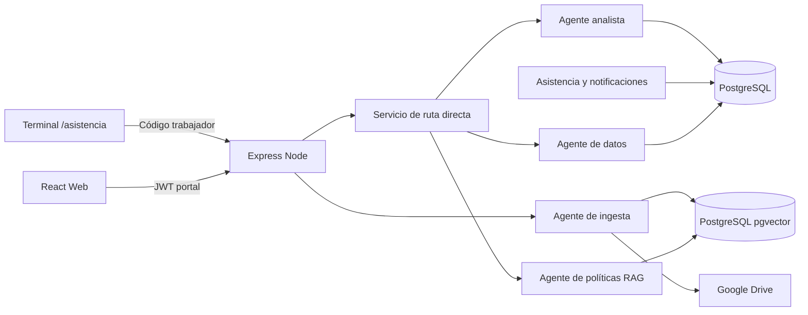

# Arquitectura

No existe un orquestador LLM separado. Express clasifica las solicitudes mediante reglas deterministas y delega a servicios especializados.

## Asistencia y reportes

- `/asistencia` es una ruta pública de terminal: el código de cinco dígitos registra la entrada si no hay una jornada abierta y la salida si la hay. No crea una sesión de portal ni muestra el perfil del colaborador.
- `/attendance` requiere autenticación y es de solo lectura: muestra el historial y las notificaciones propias del colaborador.
- `colaboradores.codigo_trabajador` identifica las cuentas de prueba con un código numérico de cinco dígitos. Los códigos de la semilla son solo para desarrollo.
- `db:seed:attendance-demo` agrega cuentas faltantes, horarios e historial reciente de prueba de forma idempotente; a diferencia de `db:seed`, no trunca tablas.
- `horarios_laborales` conserva la jornada programada por día de semana. La semilla asigna lunes a viernes de 08:00 a 17:00 a cinco colaboradores simulados.
- `marcas_asistencia` registra fecha local, entrada, salida, horario programado usado como referencia y si la salida fue anticipada. Las marcas se sellan con la hora del servidor en `America/Costa_Rica`.
- `notificaciones_colaborador` guarda las alertas de salida anticipada, asociadas a la marca y al colaborador correspondiente. Cada colaborador consulta solo sus propias marcas y notificaciones.
- El agente analista agrega conteos diarios de asistencia y una serie de 30 días en `reportes_diarios.datos_json`; el dashboard de RRHH lee dichos reportes y conserva su historial. Los avisos son internos al portal, con notificación del navegador opcional.

El horario de demostración no es una política general ni reemplaza el horario contractual. La política aplicable está en [04-jornada-asistencia.md](politicas/04-jornada-asistencia.md).
